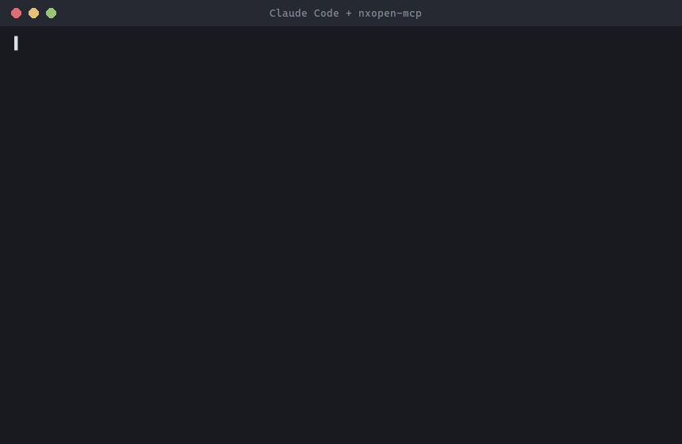
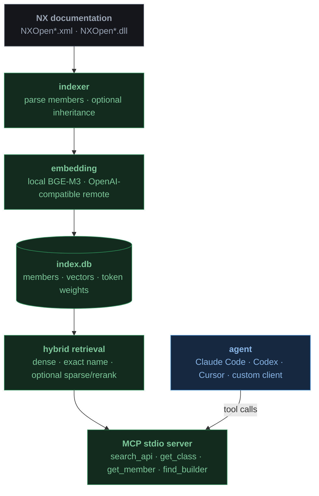

# nxopen-mcp-enhanced

[中文](README.md) | English

Give agents the real NXOpen .NET API instead of invented classes and signatures.

`NX 12 docs` · `Python 3.11+` · `MCP stdio` · `v1.0.0` · `MIT`

## Contents

- [Background](#background)
- [Features](#features)
- [Architecture](#architecture)
- [Installation](#installation)
- [Behavior and limitations](#behavior-and-limitations)
- [Tests](#tests)
- [License](#license)

## Background

LLMs hallucinate NXOpen APIs: it is a narrow domain (Siemens NX CAM/CAD automation) with sparse public training data, so models confidently invent classes, methods, and parameters that do not exist. This MCP indexes the official documentation from your own NX installation so agents retrieve against real APIs instead of memory.

The repository is an enhanced fork of [`mingfeng6684/nxopen-mcp`](https://github.com/mingfeng6684/nxopen-mcp) 0.2.0 and the MCP component of [nxopen-journal-toolkit](https://github.com/EVOL233awa/nxopen-journal-toolkit). It can be installed standalone (API retrieval only); it is best used with the [`nxopen-journal`](https://github.com/EVOL233awa/nxopen-journal) skill: the MCP supplies API facts, the skill supplies NX 12 journal recipes, batch entry points, and artifact gates.

Changes vs. upstream 0.2.0:

| Area | Upstream | This fork |
|---|---|---|
| Package / module / command | `nxopen-mcp` / `nxopen_mcp` / `nxopen-mcp` | `nxopen-mcp-enhanced` / `nxopen_mcp_enhanced` / `nxopen-mcp-enhanced` |
| Default data directory | `~/.nxopen-mcp/` | `~/.nxopen-mcp-enhanced/` (coexists with upstream) |
| Embeddings | In-process local BGE-M3 | Local BGE-M3 or OpenAI-compatible remote embedding |
| Reranking | None | Optional `/v1/rerank`; unique names skip it |
| Offline behavior | Fails when the embedding service is down | Whole names and CamelCase tokens fall back to local exact matches |
| `get_class` | Returns all members at once | Paginated `offset` / `limit` |
| Concurrency | Synchronous handlers | Async; `get_class` / `get_member` answer during slow searches |
| NX 12 XML discovery | `UGII/managed` | Also `NXBIN/managed` and the install root |



## Features

**Semantic search**
BGE-M3 dense vectors find APIs from natural-language English or Chinese queries; use `search_api` when you do not know the exact class or member name.

**Exact-name channel**
A CamelCase name in the query (such as `CavityMillingBuilder`) is looked up directly and pinned to the top, types first, rather than left to approximate matching.

**Optional reranking**
Reorders the first 20 candidates with a 15 s timeout and falls back to the unranked order; unique exact names skip it. Evaluation shows +12.3 pt Recall@5 over dense alone.

**Offline fallback**
When the embedding service is unreachable, whole names (`Part`, `Session`, `NXOpen.Features.ExtrudeBuilder`) and CamelCase tokens in the query fall back to local exact matches with a notice on the first line; other queries fail.

**Paging and concurrency**
`get_class` supports `offset` / `limit` (default 200, footer shows the total and next offset); handlers are async, so `get_class` / `get_member` still answer during a slow semantic query.

**Deployment**
Local and offline by default; the index is built from your licensed NX installation and no Siemens files are bundled or uploaded. Any OpenAI-compatible embedding/reranking service can be used instead.

| Tool | Purpose |
|---|---|
| `search_api` | Hybrid semantic API search; use when you do not know the exact class or member name |
| `get_class` | Member list and inheritance chain for a class, paginated; use when you know the class name |
| `get_member` | Exact signature, parameters, return value, NX version, and license for one member |
| `find_builder` | Given a CAM operation name (e.g. “cavity milling”), find the matching `*Builder` and creation skeleton |

## Architecture



The repository is layered by indexing, retrieval, and serving:

```text
nxopen-mcp-enhanced/
├── src/nxopen_mcp_enhanced/
│   ├── indexer/        XML parsing, embedding, index building
│   ├── retrieval/      exact-name lookup, hybrid retrieval, optional reranking
│   ├── server.py       four MCP tools (FastMCP, stdio)
│   └── cli.py          index / serve
├── eval/               golden queries and hallucination scoring
├── tests/              unit and integration tests
└── docs/               demo images
```

## Installation

Quick start: copy the whole block below to an agent on any host. It installs this package, chooses an embedding backend, builds the index, registers the MCP, and runs the self-check. Changes are in [CHANGELOG.md](CHANGELOG.md).

```text
Task: install and verify nxopen-mcp-enhanced on this machine so MCP clients can retrieve the NXOpen .NET API.

Prerequisites (stop and report if any is missing; do not skip):
- Windows 11 (other platforms untested).
- Siemens NX 12 installed; NXOpen*.xml is readable (usually <NX install root>\NXBIN\managed).
- Host Python 3.11+ (python -V).

Steps:
1. Install this package (not on PyPI; install from GitHub Releases):
   python -m pip install https://github.com/EVOL233awa/nxopen-mcp-enhanced/releases/download/v1.0.0/nxopen_mcp_enhanced-1.0.0-py3-none-any.whl
   Optional: python -m pip install pythonnet (show inherited members in get_class).
2. Choose an embedding backend:
   - Remote (recommended, no model download): requires an OpenAI-compatible service. Put the
     following variables in the MCP configuration env, and set the same values in the shell that
     builds the index:
     NXOPEN_MCP_EMBEDDER=remote
     NXOPEN_MCP_EMBED_URL=https://api.siliconflow.cn
     NXOPEN_MCP_EMBED_MODEL=BAAI/bge-m3
     NXOPEN_MCP_EMBED_API_KEY=<ask the user; do not echo or write to logs>
     NXOPEN_MCP_RERANK=1
     NXOPEN_MCP_RERANK_URL=https://api.siliconflow.cn/v1/rerank
     NXOPEN_MCP_RERANK_MODEL=BAAI/bge-reranker-v2-m3
     NXOPEN_MCP_RERANK_API_KEY=<same API key>
   - Local (offline): python -m pip install FlagEmbedding; the first run downloads about 2 GB.
3. Build the index:
   nxopen-mcp-enhanced index --nx-path <NX install root>
   (the root NX_HOME points to, commonly D:\UG-NX12). The default output is
   ~/.nxopen-mcp-enhanced/index.db; a full index may take hours: run it in the background, report
   progress periodically, and do not interrupt it.
4. Register the MCP (stdio):
   - Command: nxopen-mcp-enhanced serve --db <index path>.
   - Register it in your host's MCP configuration format. Generic JSON:
     {"mcpServers":{"nxopen":{"command":"nxopen-mcp-enhanced","args":["serve","--db","<index path>"]}}}
5. Self-check:
   - Call get_member (argument "Tag") from your host's MCP client and confirm it returns a member;
     then call search_api (query "create extrude builder") and confirm semantic search works.
   - For failures, include the last 50 lines of raw output; do not report only the exit code; do not
     claim unverified steps passed; do not echo the API key.
6. Report:
   - Install path, package version, index path and size, MCP registration location, and both
     self-check results.
```

You can also install manually with the steps below.

### Install from a release

The package is not on PyPI; the wheel is attached to a GitHub release:

```bash
python -m pip install https://github.com/EVOL233awa/nxopen-mcp-enhanced/releases/download/v1.0.0/nxopen_mcp_enhanced-1.0.0-py3-none-any.whl
```

Optional dependencies:

```bash
pip install pythonnet        # show inherited members in get_class
pip install FlagEmbedding    # local embedding; downloads about 2 GB of models on first use
```

With `nxopen-journal-toolkit`, this package is still installed by `pip`; `nxjt install` registers the MCP and `nxjt index` builds the index. The manual commands above are the standalone path.

| Command | Purpose |
|---|---|
| `nxopen-mcp-enhanced index --nx-path <path> [--db <path>] [--workers N]` | Build the index from NX documentation |
| `nxopen-mcp-enhanced serve [--db <path>]` | Start the MCP stdio server |

### Build the index

```bash
nxopen-mcp-enhanced index --nx-path "D:\Siemens\NX12.0"
```

`index` looks for `NXOpen*.xml` under `<nx-path>\UGII\managed`, then `<nx-path>\NXBIN\managed`, then `<nx-path>` itself, and for `NXOpen*.dll` in the directory where the XML was found. The default output is `~/.nxopen-mcp-enhanced/index.db`; override it with `--db`.

A full NX 12 documentation set has about 100,000 members. Local embedding is memory-bandwidth-bound and takes hours; `--workers N` submits batches in parallel and resumes after interruption. Remote embedding depends on the provider's rate limit and the network.

### Register the MCP

Generic stdio JSON:

```json
{
  "mcpServers": {
    "nxopen": {
      "command": "nxopen-mcp-enhanced",
      "args": ["serve"]
    }
  }
}
```

Pass a non-default index path explicitly:

```json
{
  "mcpServers": {
    "nxopen": {
      "command": "nxopen-mcp-enhanced",
      "args": ["serve", "--db", "D:\\path\\to\\index.db"]
    }
  }
}
```

Common hosts:

| Host | Registration |
|---|---|
| Claude Code | `claude mcp add -s user nxopen -- nxopen-mcp-enhanced serve` |
| Codex | `[mcp_servers.nxopen]` in `~/.codex/config.toml`, or `codex mcp add nxopen -- nxopen-mcp-enhanced serve` |
| Cursor | Project `.cursor/mcp.json` or Settings → MCP |
| Other | Follow the host documentation and write the generic JSON above |

If `nxopen-mcp-enhanced` is not on PATH (for example, installed in a venv), use the full executable path (Windows: `<venv>\Scripts\nxopen-mcp-enhanced.exe`) in commands and configs.

### Configure remote embedding and reranking

SiliconFlow is the recommended provider: `BAAI/bge-m3` (1024-dim embeddings) and `BAAI/bge-reranker-v2-m3` (reranking) are listed as free models on its official pricing page and match this fork's defaults, so retrieval quality is unchanged while the local model and compute disappear. The free tier has fixed rate limits and requires identity verification; `Pro/` variants of the same models are paid fast tiers. Check the [pricing page](https://siliconflow.cn/pricing) and your console for current terms.

The remote path installs no `FlagEmbedding` and downloads no model. Set these before `index` and `serve`:

| Setting | Description | Default |
|---|---|---|
| `NXOPEN_MCP_EMBEDDER` | `remote` / `openai` for an OpenAI-compatible service; `ollama` for Ollama; unset for local BGE-M3 | unset (local) |
| `NXOPEN_MCP_EMBED_URL` | Remote embedding base URL | `http://127.0.0.1:11436` |
| `NXOPEN_MCP_EMBED_MODEL` | Remote embedding model name | `bge-m3` |
| `NXOPEN_MCP_EMBED_API_KEY` | Remote embedding bearer token | empty |
| `NXOPEN_MCP_RERANK` | Set to `1` / `true` / `on` to enable reranking | off |
| `NXOPEN_MCP_RERANK_URL` | Reranking endpoint | `http://127.0.0.1:8000/v1/rerank` |
| `NXOPEN_MCP_RERANK_MODEL` | Reranking model name; empty sends no `model` | empty |
| `NXOPEN_MCP_RERANK_API_KEY` | Reranking bearer token | empty |

`index` and `serve` must use the same settings: vectors come from whichever model built the index, so changing models requires a rebuild. With `nxopen-journal-toolkit`, `nxjt config embed --provider remote` writes these variables into the MCP client configuration (format depends on the host), and `nxjt index` reuses them.

### Install from source

```bash
git clone https://github.com/EVOL233awa/nxopen-mcp-enhanced
cd nxopen-mcp-enhanced
pip install -e ".[reflect]"        # use ".[embed,reflect]" for local embeddings
```

## Behavior and limitations

- When the embedding service is unreachable: whole names and CamelCase tokens fall back to local exact matches with a notice on the first line; other queries fail.
- When the reranking service is unreachable: queries wait for the 15 s timeout and then return the unranked order.
- When the first semantic query runs (local path): `serve` is already up and `get_class` / `get_member` answer immediately, but `search_api` / `find_builder` wait for BGE-M3 to load; the remote path has no such step.
- When switching to a different embedding model: rebuild the index; when the same model is served locally and remotely, the index can be reused.
- Short Chinese-only queries of 2–4 characters still miss (`拉伸` returns `RelaxationLength`); add an English term (`创建拉伸特征 extrusion`) or use `get_class` / `get_member` by name.
- No index or NX documentation is bundled; without an index none of the four tools work. A full index takes hours (local embedding) or network access (remote embedding).
- Remote mode sends query and document text to the embedding/reranking service; the index file stays local.
- Only NX 12 documentation is verified; XML layouts from other NX versions are untested.

## Tests

```bash
python -m pytest -q
python eval/run_eval.py --db ~/.nxopen-mcp-enhanced/index.db
python eval/halluc_test.py collect --out answers.jsonl
python eval/halluc_test.py grade --answers answers.jsonl
```

Evaluation runs on a real NX 12 index (95,807 API members) against 73 golden queries (`eval/golden.jsonl`, mixed English/Traditional Chinese, four query styles: semantic description, exact class name, member lookup, builder idiom). Remote `BAAI/bge-m3` embeddings + `BAAI/bge-reranker-v2-m3` reranking:

| Configuration | Recall@5 | Recall@10 | MRR |
|---|---|---|---|
| dense-only | 56.16% | 67.12% | 0.411 |
| dense+exact | 57.53% | 67.12% | 0.437 |
| **dense+exact+rerank (recommended)** | **69.86%** | **78.08%** | **0.531** |

The hallucination test uses one model (`deepseek-v4.1-flash-1017`, max thinking), the same 33 questions, and one variable: whether the four tools are reachable over MCP function calling. Grading is mechanical: every identifier in an answer is checked against NXOpen reflection after the oracle self-calibrates (14 known-real names must be accepted, 7 known-fake names rejected).

| Metric | Without MCP | With MCP |
|---|:---:|:---:|
| Exactly correct | 4/33 (12.1%) | **19/33 (57.6%)** |
| Hallucinated (API does not exist) | **29/33 (87.9%)** | 14/33 (42.4%) |
| Total time | 3241 s | 1937 s |
| Total tokens (completion side, reasoning included) | 367k | 186k |

## License

Code is MIT; see [LICENSE](LICENSE). The repository contains no Siemens files — no NXOpen XML, no DLLs. The index is built locally from your own licensed NX installation's documentation and never leaves the machine.

The index embeds text from Siemens API documentation. Building it locally from your own licensed NX installation is what `nxopen-mcp-enhanced index` does; use such an index only within an organization whose seats are licensed for NX. **Do not redistribute index files publicly** — anyone outside your license should build their own.

NX, NXOpen, and NX Nastran are trademarks of Siemens; this repository does not distribute Siemens documentation, binaries, or indexes.
