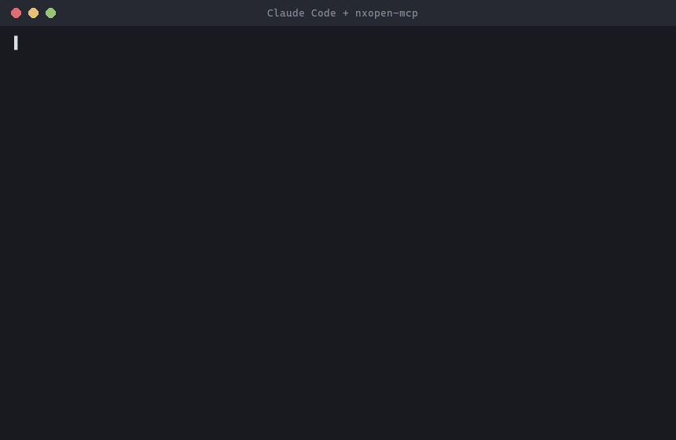
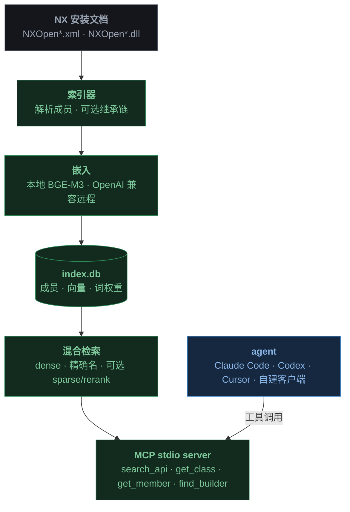

# nxopen-mcp-enhanced

[English](README.en.md) | 中文

让 agent 查真实的 NXOpen .NET API，而不是编造类名与签名。

`NX 12 docs` · `Python 3.11+` · `MCP stdio` · `v1.0.0` · `MIT`

## 目录

- [背景](#背景)
- [特性](#特性)
- [架构](#架构)
- [安装](#安装)
- [行为说明与已知限制](#行为说明与已知限制)
- [测试](#测试)
- [许可证](#许可证)

## 背景

LLM 会编造 NXOpen API：这是西门子 NX CAM/CAD 自动化的窄领域，公开训练数据少，模型会自信地写出不存在的类、方法与参数。本 MCP 用你自己 NX 安装里的官方文档建索引，让 agent 按真实 API 检索，而不是靠记忆。

仓库是 [`mingfeng6684/nxopen-mcp`](https://github.com/mingfeng6684/nxopen-mcp) 0.2.0 的增强 fork，也是 [nxopen-journal-toolkit](https://github.com/EVOL233awa/nxopen-journal-toolkit) 的 MCP 组件。可以单独安装（只做 API 检索），推荐与 [`nxopen-journal`](https://github.com/EVOL233awa/nxopen-journal) 技能一起用：MCP 提供 API 事实，技能提供 NX 12 journal 配方、批处理入口与产物校验门。

相对上游 0.2.0 的改动：

| 方面 | 上游 | 本 fork |
|---|---|---|
| 包名 / 模块 / 命令 | `nxopen-mcp` / `nxopen_mcp` / `nxopen-mcp` | `nxopen-mcp-enhanced` / `nxopen_mcp_enhanced` / `nxopen-mcp-enhanced` |
| 默认数据目录 | `~/.nxopen-mcp/` | `~/.nxopen-mcp-enhanced/`（可与上游共存） |
| 嵌入 | 进程内本地 BGE-M3 | 本地 BGE-M3 或 OpenAI 兼容远程嵌入 |
| 重排 | 无 | 可选 `/v1/rerank`，唯一名跳过 |
| 断网行为 | 嵌入服务不可用即失败 | 整串名与驼峰标识符回退本地精确匹配 |
| `get_class` | 一次返回全部成员 | 分页 `offset` / `limit` |
| 并发 | 同步工具处理 | 异步；慢查询期间 `get_class` / `get_member` 不被阻塞 |
| NX 12 XML 发现 | `UGII/managed` | 兼查 `NXBIN/managed` 与安装根 |



## 特性

**语义检索**
BGE-M3 dense 向量，中英文自然语言查询都能找到 API；不知道确切类名或成员名时用 `search_api`。

**精确名通道**
查询里的 CamelCase 名字（如 `CavityMillingBuilder`）直接查库并置顶，类型优先，不交给近似匹配。

**可选重排**
对前 20 个候选重新排序，15 s 超时，失败回退未重排顺序；唯一精确名跳过。评测中 Recall@5 比纯 dense 高 12.3 pt。

**离线回退**
嵌入服务不可达时，整串名（`Part`、`Session`、`NXOpen.Features.ExtrudeBuilder`）与查询中的 CamelCase token 回退本地精确匹配，并在首行标注；其他查询报错。

**分页与并发**
`get_class` 支持 `offset` / `limit`（默认 200，末尾给总数与下一个 offset）；工具处理是异步的，慢语义查询期间 `get_class` / `get_member` 仍可回答。

**部署**
默认全程本地、离线，索引由本机授权的 NX 安装构建，不附带、不上传 Siemens 文件；也可接任意 OpenAI 兼容嵌入/重排服务。

| 工具 | 用途 |
|---|---|
| `search_api` | API 混合语义检索；不知道确切类名或成员名时用 |
| `get_class` | 类的成员列表与继承链，分页返回；知道类名时用 |
| `get_member` | 单个成员的精确签名、参数、返回、NX 版本与 license |
| `find_builder` | 由 CAM 工序名（如 “cavity milling”）找对应 `*Builder` 与创建骨架 |

## 架构



仓库按索引、检索、服务分层：

```text
nxopen-mcp-enhanced/
├── src/nxopen_mcp_enhanced/
│   ├── indexer/        XML 解析、嵌入、索引构建
│   ├── retrieval/      精确名查询、混合检索、可选重排
│   ├── server.py       四个 MCP 工具（FastMCP，stdio）
│   └── cli.py          index / serve
├── eval/               golden 查询与幻觉得分脚本
├── tests/              单元与集成测试
└── docs/               演示图
```

## 安装

快速开始：把下面整段复制给任意宿主的 agent；它安装本包、选择嵌入后端、建索引、注册 MCP 并自检。变更见 [CHANGELOG.md](CHANGELOG.md)。

```text
任务：在本机安装并验证 nxopen-mcp-enhanced，供 MCP 客户端检索 NXOpen .NET API。

环境前提（缺一即停并报告，不要跳过）：
- Windows 11（其他平台未验证）。
- Siemens NX 12 安装；能读到 NXOpen*.xml（通常在 <NX 安装根>\NXBIN\managed）。
- 宿主 Python 3.11+（python -V）。

步骤：
1. 安装本包（未发布到 PyPI，从 GitHub Release 安装）：
   python -m pip install https://github.com/EVOL233awa/nxopen-mcp-enhanced/releases/download/v1.0.0/nxopen_mcp_enhanced-1.0.0-py3-none-any.whl
   可选：python -m pip install pythonnet（get_class 显示继承链）。
2. 选择嵌入后端：
   - 远程（推荐，不下载模型）：需要 OpenAI 兼容服务。把以下变量写入 MCP 配置的 env，
     并在建索引的 shell 里设为同样的值：
     NXOPEN_MCP_EMBEDDER=remote
     NXOPEN_MCP_EMBED_URL=https://api.siliconflow.cn
     NXOPEN_MCP_EMBED_MODEL=BAAI/bge-m3
     NXOPEN_MCP_EMBED_API_KEY=<向用户索取；不要回显或写入日志>
     NXOPEN_MCP_RERANK=1
     NXOPEN_MCP_RERANK_URL=https://api.siliconflow.cn/v1/rerank
     NXOPEN_MCP_RERANK_MODEL=BAAI/bge-reranker-v2-m3
     NXOPEN_MCP_RERANK_API_KEY=<同 API key>
   - 本地（离线）：python -m pip install FlagEmbedding，首次下载约 2 GB。
3. 建索引：
   nxopen-mcp-enhanced index --nx-path <NX 安装根>
   （NX_HOME 指向的安装根，常见为 D:\UG-NX12）。默认写入 ~/.nxopen-mcp-enhanced/index.db；
   全量索引可能数小时，后台运行并定期报告进度，不要中断。
4. 注册 MCP（stdio）：
   - 命令：nxopen-mcp-enhanced serve --db <索引路径>。
   - 按宿主的 MCP 配置格式注册，通用 JSON：
     {"mcpServers":{"nxopen":{"command":"nxopen-mcp-enhanced","args":["serve","--db","<索引路径>"]}}}
5. 自检：
   - 在宿主的 MCP 客户端里调用 get_member（参数 "Tag"），确认返回成员；
     再调用 search_api（查询 "create extrude builder"），确认语义检索可用。
   - 失败项附原始输出末尾 50 行；不要只报退出码；不要声称未验证的步骤已通过；不要回显 API key。
6. 报告：
   - 安装路径、包版本、索引路径与大小、MCP 注册位置、两项自检结果。
```

也可以按下面的步骤手动安装。

### 从 Release 安装

本包未发布到 PyPI，wheel 挂在 GitHub Release：

```bash
python -m pip install https://github.com/EVOL233awa/nxopen-mcp-enhanced/releases/download/v1.0.0/nxopen_mcp_enhanced-1.0.0-py3-none-any.whl
```

可选依赖：

```bash
pip install pythonnet        # get_class 显示继承链
pip install FlagEmbedding    # 本地嵌入路线；首次下载约 2 GB 模型
```

用 `nxopen-journal-toolkit` 时，本包仍由 `pip` 安装；`nxjt install` 负责注册 MCP，`nxjt index` 建索引。上面的手工命令是单独安装路线。

| 命令 | 作用 |
|---|---|
| `nxopen-mcp-enhanced index --nx-path <path> [--db <path>] [--workers N]` | 用 NX 文档建索引 |
| `nxopen-mcp-enhanced serve [--db <path>]` | 启动 MCP stdio server |

### 建索引

```bash
nxopen-mcp-enhanced index --nx-path "D:\Siemens\NX12.0"
```

`index` 依次在 `<nx-path>\UGII\managed`、`<nx-path>\NXBIN\managed`、`<nx-path>` 下找 `NXOpen*.xml`，并在找到 XML 的目录里找 `NXOpen*.dll`。默认写入 `~/.nxopen-mcp-enhanced/index.db`，可用 `--db` 覆盖。

全量 NX 12 文档约 10 万成员。本地嵌入受内存带宽限制，耗时以小时计；`--workers N` 并行提交批次，中断后可续建。远程嵌入取决于服务端限速与网络。

### 注册 MCP

通用 stdio JSON：

```json
{
  "mcpServers": {
    "nxopen": {
      "command": "nxopen-mcp-enhanced",
      "args": ["serve"]
    }
  }
}
```

索引不在默认路径时显式传：

```json
{
  "mcpServers": {
    "nxopen": {
      "command": "nxopen-mcp-enhanced",
      "args": ["serve", "--db", "D:\\path\\to\\index.db"]
    }
  }
}
```

常见宿主：

| 宿主 | 注册方式 |
|---|---|
| Claude Code | `claude mcp add -s user nxopen -- nxopen-mcp-enhanced serve` |
| Codex | `~/.codex/config.toml` 的 `[mcp_servers.nxopen]`，或 `codex mcp add nxopen -- nxopen-mcp-enhanced serve` |
| Cursor | 项目 `.cursor/mcp.json` 或 Settings → MCP |
| 其他 | 按宿主文档写入上面的通用 JSON |

`nxopen-mcp-enhanced` 不在 PATH 时（例如装在 venv），命令与配置里用完整可执行文件路径（Windows：`<venv>\Scripts\nxopen-mcp-enhanced.exe`）。

### 配置远程嵌入与重排

推荐接硅基流动：`BAAI/bge-m3`（嵌入，1024 维）与 `BAAI/bge-reranker-v2-m3`（重排）在官方价格页标为免费，与本 fork 的默认模型一致，检索质量不变、只省掉本地模型与算力。免费档有固定 Rate Limits、需要实名认证，`Pro/` 前缀的同名模型是收费加速档；价格与限速以[价格页](https://siliconflow.cn/pricing)与控制台为准。

远程路线不装 `FlagEmbedding`、不下载模型，在 `index` 与 `serve` 前设置：

| 配置项 | 说明 | 默认值 |
|---|---|---|
| `NXOPEN_MCP_EMBEDDER` | `remote` / `openai` 用 OpenAI 兼容服务；`ollama` 用 Ollama；不设用本地 BGE-M3 | 未设置（本地） |
| `NXOPEN_MCP_EMBED_URL` | 远程嵌入 base URL | `http://127.0.0.1:11436` |
| `NXOPEN_MCP_EMBED_MODEL` | 远程嵌入模型名 | `bge-m3` |
| `NXOPEN_MCP_EMBED_API_KEY` | 远程嵌入 bearer token | 空 |
| `NXOPEN_MCP_RERANK` | 设为 `1` / `true` / `on` 开启重排 | 关闭 |
| `NXOPEN_MCP_RERANK_URL` | 重排端点 | `http://127.0.0.1:8000/v1/rerank` |
| `NXOPEN_MCP_RERANK_MODEL` | 重排模型名；空则不发送 `model` | 空 |
| `NXOPEN_MCP_RERANK_API_KEY` | 重排 bearer token | 空 |

`index` 与 `serve` 必须用同一组变量：索引里的向量由建索引时的模型产生，换模型要重建索引。用 `nxopen-journal-toolkit` 时，`nxjt config embed --provider remote` 会把这些变量写进 MCP 客户端配置（各宿主格式不同），`nxjt index` 沿用同一组变量。

### 源码安装

```bash
git clone https://github.com/EVOL233awa/nxopen-mcp-enhanced
cd nxopen-mcp-enhanced
pip install -e ".[reflect]"        # 本地嵌入路线用 ".[embed,reflect]"
```

## 行为说明与已知限制

- 当嵌入服务不可达时：整串名与 CamelCase token 回退本地精确匹配，首行标注；其他查询报错。
- 当重排服务不可达时：等 15 s 超时后回退未重排顺序，不影响结果返回。
- 当第一次语义查询时（本地路线）：`serve` 已启动，`get_class` / `get_member` 立即响应，但 `search_api` / `find_builder` 要等 BGE-M3 加载；远程路线没有这一步。
- 当换用不同的嵌入模型时：必须重建索引；本地与云端部署的是同一模型时，索引可直接复用。
- 纯中文 2–4 字查询仍会失手（`拉伸` 会查到 `RelaxationLength`）；补英文术语（`创建拉伸特征 extrusion`），或按名走 `get_class` / `get_member`。
- 本包不附带索引和 NX 文档；没有索引时四个工具都不可用。全量索引需要数小时（本地嵌入）或网络（远程嵌入）。
- 远程模式会把查询与文档文本发到嵌入/重排服务；索引文件始终在本机。
- 只验证 NX 12 文档；其他 NX 版本的 XML 结构未验证。

## 测试

```bash
python -m pytest -q
python eval/run_eval.py --db ~/.nxopen-mcp-enhanced/index.db
python eval/halluc_test.py collect --out answers.jsonl
python eval/halluc_test.py grade --answers answers.jsonl
```

评测在真实 NX 12 索引（95,807 个 API 成员）与 73 条 golden query 上跑（`eval/golden.jsonl`，英文/繁体中文混合，四种查询类型：语义描述、精确类名、成员查找、builder 惯用法）。远程 `BAAI/bge-m3` 嵌入 + `BAAI/bge-reranker-v2-m3` 重排：

| 配置 | Recall@5 | Recall@10 | MRR |
|---|---|---|---|
| dense-only | 56.16% | 67.12% | 0.411 |
| dense+exact | 57.53% | 67.12% | 0.437 |
| **dense+exact+rerank（推荐）** | **69.86%** | **78.08%** | **0.531** |

幻觉测试用同一模型（`deepseek-v4.1-flash-1017`，max 思考深度）、同一组 33 条问题，唯一变量是四个工具能否通过 MCP 函数调用拿到。判分是机械的：答案里的每个标识符都拿到 NXOpen 反射里核对，判据先自校准（14 个已知真实名必须接受、7 个已知假名必须拒绝）。

| 指标 | 无 MCP | 有 MCP |
|---|:---:|:---:|
| 完全正确 | 4/33（12.1%） | **19/33（57.6%）** |
| 幻觉（API 不存在） | **29/33（87.9%）** | 14/33（42.4%） |
| 总耗时 | 3241 s | 1937 s |
| 总消耗 token（完成侧，含思考） | 367k | 186k |

## 许可证

代码 MIT，见 [LICENSE](LICENSE)。仓库不含任何 Siemens 文件——没有 NXOpen XML，也没有 DLL；索引由本机授权的 NX 安装文档在本地构建，不离开本机。

索引内嵌了 Siemens API 文档文本。用本机授权的 NX 安装构建索引是 `nxopen-mcp-enhanced index` 做的事；这样的索引只在持有 NX 授权的组织内部使用。**不要公开分发索引文件**，授权范围外的用户应自行构建。

NX、NXOpen、NX Nastran 是 Siemens 的商标；本仓库不分发 Siemens 的文档、二进制或索引。
