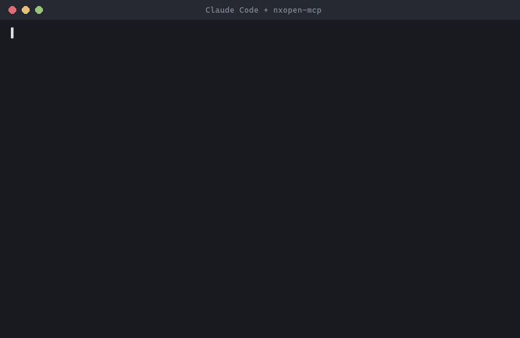

# nxopen-mcp-enhanced

[English](README.md) | **简体中文**

> **增强 fork**：上游为 [mingfeng6684/nxopen-mcp](https://github.com/mingfeng6684/nxopen-mcp)，
> 同时是 [nxopen-journal-toolkit](https://github.com/EVOL233awa/nxopen-journal-toolkit) 的 MCP 组件。

本 fork 可以**单独安装**（只做 NXOpen API 检索），但**推荐与
[`nxopen-journal`](https://github.com/EVOL233awa/nxopen-journal) 技能一起安装**：MCP 提供真实的
NXOpen API 事实，技能提供 NX 12 journal 配方、批处理入口与产物校验门。`nxopen-journal-toolkit`
负责把两者装在一起并统一自检。

### 相对上游的改动

| 方面 | 上游 `nxopen-mcp` 0.2.0 | 本 fork |
|---|---|---|
| 包名 / 模块 / 命令 | `nxopen-mcp` / `nxopen_mcp` / `nxopen-mcp` | `nxopen-mcp-enhanced` / `nxopen_mcp_enhanced` / `nxopen-mcp-enhanced` |
| 默认数据目录 | `~/.nxopen-mcp/` | `~/.nxopen-mcp-enhanced/`（可与上游共存） |
| 嵌入 | 进程内本地 BGE-M3 | 本地 BGE-M3 **或** OpenAI 兼容远程嵌入 |
| 重排 | 无 | 可选 `/v1/rerank`（bge-reranker-v2-m3），15 s 超时，唯一名跳过；**推荐开启**（Recall@5 +12.3 pt） |
| 断网行为 | 嵌入服务不可用即失败 | 整串名与驼峰标识符回退本地精确匹配，首行标注 |
| `get_class` | 一次返回全部成员 | 分页 `offset`/`limit`（默认 200，末尾给总数与下一个 offset） |
| 并发 | 同步工具处理 | 异步（`asyncio.to_thread`）；慢查询期间 `get_class`/`get_member` 不被阻塞 |
| NX 12 XML 发现 | `UGII/managed` | 兼查 `NXBIN/managed` 与安装根 |

本地 BGE-M3 检索路径未改；新增能力均可选或向后兼容。

## 为什么需要它

LLM 会编造 NXOpen API：这是西门子 NX CAM/CAD 自动化的窄领域，公开训练数据少，模型会自信地
写出不存在的类、方法与参数。本 MCP 用你自己 NX 安装里的官方文档做检索，而不是靠记忆：

- **语义检索**（BGE-M3 dense 向量）：中英文自然语言查询也能找到 API。
- **精确名通道**：查询里的 CamelCase 名字（如 `CavityMillingBuilder`）直接查库并置顶（类型优先），
  不交给近似匹配。
- **可选重排**：对前若干候选重新排序，评测显示这是更值得开的配置（见下文“评测”）。

默认全程本地、离线，索引由本机授权的 NX 安装构建，不附带、不上传任何 Siemens 文件。推荐的
部署再加一个外部嵌入/重排服务（见“远程嵌入与重排”），开启后只有查询与文档文本离开本机。

## 快速开始

需要 **Python 3.11+**。

```bash
# 1. 从本仓库安装（尚未发布到 PyPI）
git clone https://github.com/EVOL233awa/nxopen-mcp-enhanced
cd nxopen-mcp-enhanced
# 推荐：远程嵌入 + 重排（硅基流动的 BAAI/bge-m3 与 BAAI/bge-reranker-v2-m3 免费，
#   不下载模型）；先按“远程嵌入与重排”一节设好 NXOPEN_MCP_*，再建索引
pip install -e ".[reflect]"
# 或全程本地、离线：首次使用下载约 2 GB 的 BGE-M3
# pip install -e ".[embed,reflect]"

# 2. 用你的 NX 安装目录建一次索引
nxopen-mcp-enhanced index --nx-path "D:\Siemens\NX12.0"

# 3. 注册到 Claude Code（用户级，所有项目可用）
claude mcp add -s user nxopen -- nxopen-mcp-enhanced serve

# 4. 让 agent 写 NXOpen 代码，它会先查真实 API。
```

用 `nxopen-journal-toolkit` 时，`nxjt install` 完成第 1、3 步，`nxjt index` 完成第 2 步；上面的
手工命令是单独安装路线。

`index` 依次在 `<nx-path>\UGII\managed`、`<nx-path>\NXBIN\managed`、`<nx-path>` 下找
`NXOpen*.xml`，并在同一批目录找 `NXOpen*.dll`。

可选依赖：`[embed]` 拉入 `FlagEmbedding`（约 2 GB 模型，只有本地嵌入路线才需要）；`[reflect]`
拉入 `pythonnet`，`get_class` 才能显示继承链；不装也能建索引，只是没有继承成员。

**建索引要多久？** 全量 NX 12 文档约 10 万成员。本地嵌入受内存带宽限制，耗时以小时计；
远程嵌入取决于服务端限速与网络，`--workers` 并发提交批次。

**首次语义查询慢是设计行为（本地嵌入路线）。** `serve` 立即启动，`get_class` / `get_member`
立即响应；第一次 `search_api` / `find_builder` 要加载 BGE-M3。客户端看起来“卡住”时，等它
加载完。远程嵌入路线没有这一步。

默认索引在 `~/.nxopen-mcp-enhanced/index.db`；`index` 与 `serve` 都可用 `--db <path>` 覆盖。

## 远程嵌入与重排（推荐）

**推荐接入硅基流动**：它的 `BAAI/bge-m3`（嵌入，1024 维）与 `BAAI/bge-reranker-v2-m3`（重排）
在官方价格页标为免费，与本 fork 的默认模型完全一致，所以检索质量不变、只省掉本地模型与算力。
免费档有固定 Rate Limits、需要实名认证，`Pro/` 前缀的同名模型是收费加速档；价格与限速以
[价格页](https://siliconflow.cn/pricing)与控制台为准。

远程路线不装 `[embed]`、不下载任何模型，在 `index` 与 `serve` 前设置：

| 变量 | 示例 |
|---|---|
| `NXOPEN_MCP_EMBEDDER` | `remote` |
| `NXOPEN_MCP_EMBED_URL` | `https://api.siliconflow.cn` |
| `NXOPEN_MCP_EMBED_MODEL` | `BAAI/bge-m3` |
| `NXOPEN_MCP_EMBED_API_KEY` | 你的 bearer token |
| `NXOPEN_MCP_RERANK` | `1` 开启重排 |
| `NXOPEN_MCP_RERANK_URL` | `https://api.siliconflow.cn/v1/rerank` |
| `NXOPEN_MCP_RERANK_MODEL` | `BAAI/bge-reranker-v2-m3` |
| `NXOPEN_MCP_RERANK_API_KEY` | 你的 bearer token |

任何 OpenAI 兼容的嵌入服务都可以填这一组变量（Ollama 走 `NXOPEN_MCP_EMBEDDER=ollama`）。
`index` 与 `serve` 必须用同一组变量：索引里的向量是用建索引时的模型产生的，换模型要重建索引。

行为：

- 重排只重排前 20 个候选，15 s 超时，任何错误回退到未重排顺序。
- 唯一精确名（`ExtrudeBuilder`）跳过重排；歧义短名（`Tag`、`Validate`）与自然语言查询保留重排。
- 嵌入服务不可达时，整串名（`Part`、`Session`、`NXOpen.Features.ExtrudeBuilder`）与查询中的
  CamelCase token 回退本地精确匹配，并在首行标注；其他查询报错。`get_class` / `get_member`
  不等待嵌入服务，慢语义查询进行中也能回答。
- 用 `nxopen-journal-toolkit` 时，`nxjt config embed --provider remote` 会把这些变量写进
  MCP 客户端配置（各宿主格式不同），`nxjt index` 沿用同一组变量。

如果 `nxopen-mcp-enhanced` 不在 PATH（例如装在 venv），命令与配置里用完整可执行文件路径
（Windows：`<venv>\Scripts\nxopen-mcp-enhanced.exe`）。

### Claude Code / 通用 MCP 客户端

```json
{
  "mcpServers": {
    "nxopen": {
      "command": "nxopen-mcp-enhanced",
      "args": ["serve"]
    }
  }
}
```

索引不在默认路径时显式传：

```json
{
  "mcpServers": {
    "nxopen": {
      "command": "nxopen-mcp-enhanced",
      "args": ["serve", "--db", "D:\\path\\to\\index.db"]
    }
  }
}
```

### Codex

Codex 从 `~/.codex/config.toml`（Windows：`C:\Users\<you>\.codex\config.toml`）读 MCP：

```toml
[mcp_servers.nxopen]
command = "nxopen-mcp-enhanced"
args = ["serve"]
```

或用一条命令：`codex mcp add nxopen -- nxopen-mcp-enhanced serve`。重启 Codex 后用
`codex mcp list` 确认。

### Cursor

把上面的 JSON 块加到 Cursor 的 MCP 设置（项目 `.cursor/mcp.json` 或 Settings → MCP）。

## 工具

| 工具 | 用途 |
|---|---|
| `search_api` | API 混合语义检索（默认 dense + 精确名；sparse 可选）。接受英文或中文；不知道确切类名/成员名时用。 |
| `get_class` | 类的成员列表（含继承链）。分页 `offset` / `limit`（默认 200），末尾显示总数与下一个 offset。知道类名时用。 |
| `get_member` | 单个成员的精确签名、参数、返回、NX 版本与 license。 |
| `find_builder` | 由 CAM 工序名（如 “cavity milling”、“hole drilling”）找对应 `*Builder`、创建方法与 Builder → Commit → Destroy 骨架。 |

## 架构

```text
NXOpen*.xml / *.dll（你的 NX 安装）
        │
        ▼
  indexer/parser.py        一条 XML 文档注释 -> 一条 MemberRecord
  indexer/inheritance.py   可选：反射 DLL（pythonnet）取基类链
        │
        ▼
  indexer/embedder.py      每条记录：BGE-M3 dense 向量 + sparse token 权重
        │
        ▼
  indexer/build.py         写入 members / dense_vec（sqlite-vec）/ sparse_postings
        │                  单个 SQLite 文件（index.db）
        ▼
  retrieval/store.py       精确名查询、类/成员/继承查询
  retrieval/hybrid.py      dense ANN + 精确 CamelCase（默认），可选 sparse，RRF 融合，可选重排
        │
        ▼
  server.py                4 个 MCP 工具（FastMCP，stdio）
  cli.py                   `nxopen-mcp-enhanced index` / `serve`
```

设计取舍：

- **文档自带（BYO-Docs）**：仓库不含 Siemens XML/DLL；索引由用户本机授权的 NX 文档构建，
  是本地 SQLite 文件，不上传、不入库。
- **一成员一 chunk**：每条索引是一个 API 成员（类型/属性/方法/字段/事件），检索结果能 1:1
  对应到 agent 可执行的对象，而不是文档页的文本片段。
- **RRF 而非分数混合**：启用 sparse 通道时用 Reciprocal Rank Fusion 合并排序，无需校准
  dense 与 sparse 的分数量纲；默认只跑 dense + exact，精确名匹配直接提到融合列表之前。
- **继承靠反射，可降级**：`get_class` 的继承链在建索引时用 `pythonnet` 反射 DLL 得到
  （`[reflect]`）；没装或找不到 DLL 也能建索引，只是没有继承成员。

## 评测

在真实 NX 12 索引（95,807 个 API 成员）与 73 条 golden query 上测（`eval/golden.jsonl`，
英文/繁体中文混合，四种查询类型：语义描述、精确类名、成员查找、builder 惯用法；覆盖 CAM、
Features、Sketch、Assemblies、Drawings、UF、BlockStyler）：

```bash
python eval/run_eval.py --db ~/.nxopen-mcp-enhanced/index.db
```

远程 `BAAI/bge-m3` 嵌入 + `BAAI/bge-reranker-v2-m3` 重排，同一索引、同一批查询：

| 配置 | Recall@5 | Recall@10 | MRR |
|---|---|---|---|
| dense-only | 56.16% | 67.12% | 0.411 |
| **dense+exact** | 57.53% | 67.12% | 0.437 |
| **dense+exact+rerank（推荐）** | **69.86%** | **78.08%** | **0.531** |

精确名通道保证字面类名/成员名命中，重排把前 20 个候选重新排序；两者叠加比纯 dense 的
Recall@5 高 13.7 pt。远程嵌入不提供 sparse 词权重，因此表内不含 sparse 行；本地 BGE-M3
路线可用 `search()` 的 `channels` 参数启用。

逐查询：重排改善 11、变差 2、不变 60。两条变差的都是“中文动词 + 英文名词”结构
（`取得零件的 CAM setup 物件`、`create hole feature 建立孔特徵`），重排压低了 API 字面名的分量。

另有两件实际相关的事：

- 本地 BGE-M3 与云端同名模型之间**不需要重建索引**：向量余弦 0.99988–0.99994，2,000 条重编码后
  73 条 golden 的 top-10 重合 97.1%（其余是 batch=1 与 batch=128 的浮点噪声）。
- 纯中文 2–4 字查询仍会失手（`拉伸` 查到 `RelaxationLength`）；补上英文术语
  （`创建拉伸特征 extrusion`），或按名走 `get_class` / `get_member`。

### 幻觉测试：闭卷 vs. 带工具

同一模型（`deepseek-ai/DeepSeek-V4.1-Flash`）、同一组 33 条 golden 问题、temperature 0，
唯一变量是四个工具能否通过 MCP 函数调用拿到。

判分是机械的，可复跑：答案里每个标识符（`NXOpen.*` 点路径，加上答案自己未声明的三段式以上
驼峰名）都拿到 NXOpen 反射里核对——`NXOpen.dll`、`NXOpen.Utilities.dll`、`NXOpen.UF.dll`，
接受 `类型.成员` 以及 `NXOpen.Session.Parts.Work.CAMSetup` 这类属性链。判据先自校准：
13 个已知真实名必须被接受、6 个已知假名必须被拒绝，否则本次统计作废。只用 XML 文档索引做
判据是错的——它漏掉了 `NXOpen.Session.GetSession` 这类真实成员。

```bash
python eval/halluc_test.py collect --out answers.jsonl   # 问模型
python eval/halluc_test.py grade --answers answers.jsonl # 只用反射判分
```

| 指标 | 闭卷 | 带工具 |
|---|:---:|:---:|
| 提出的标识符总数 | 405 | 637 |
| 其中不存在的标识符 | **177（43.7%）** | **23（3.6%）** |
| 完全没编名字的答案 | 4/33 | **24/33** |
| 点名正确类且全程无编造 | 4/33 | **16/33** |
| 至少提到正确类 | 29/33 | 25/33 |
| 33 题总耗时 | 311 s | 573 s |

按标识符算，编造率降到 1/12；按题目算，无编造答案从 4 条升到 24 条。“至少提到正确类”反而
下降是有原因的：闭卷答案是散文，常能点到正确的类名却把成员编错；带工具的答案是代码，直接用
被查到的成员，较少复述类名。工具带来的是不再出现发明的名字——`MillGeometryBuilder`（真名
`MillGeomBuilder`）、`CreateCavityMilling`、`NXOpen.CAM.CutMethod` 这类不再出现。

## 演示



一次真实会话：让 Claude Code 写设置主轴转速的 NXOpen 代码，它调用 `search_api`（语义检索，
中英文均可）与 `get_class`（成员 + 继承链），最后写出的每个成员——`FeedsBuilder`、
`SpindleRpmToggle`、`SpindleRpmBuilder.Value`——都在真实 API 中存在，并带 NX 版本信息。

## 索引许可边界

索引内嵌了 Siemens API 文档文本。用本机授权的 NX 安装构建索引是 `nxopen-mcp-enhanced index`
做的事；这样的索引只在持有 NX 授权的组织内部使用。**不要公开分发索引文件**，授权范围外的
用户应自行构建。

## 许可与知识产权

代码 MIT（见 [LICENSE](LICENSE)）。仓库不含任何 Siemens 文件——没有 NXOpen XML，也没有 DLL。
索引由本机授权的 NX 安装文档在本地构建，不离开本机。
